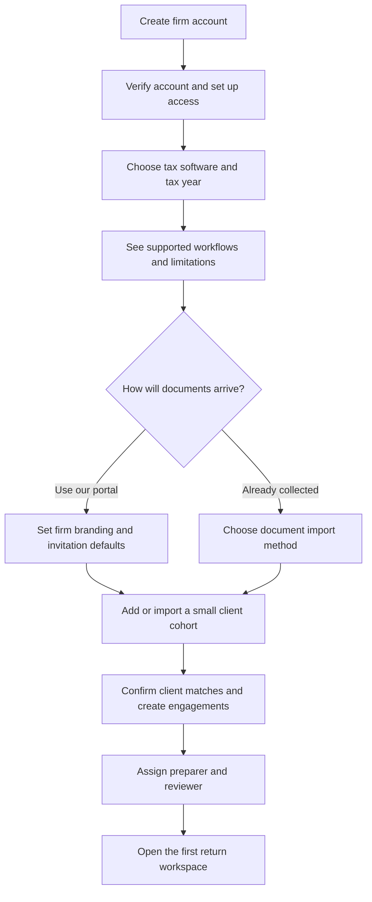
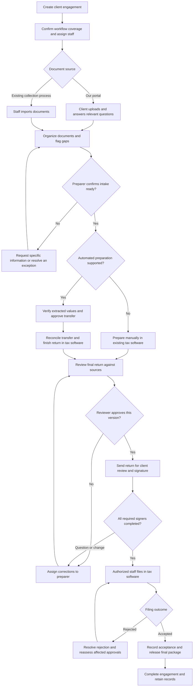
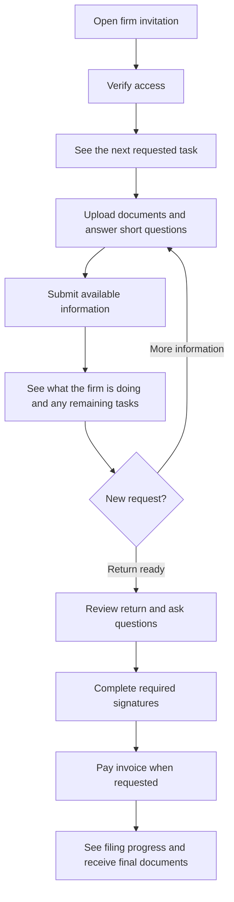

# User flow for our tax workflow platform

Proposed product design based on the competitor research dated 29 October 2026.

## Product direction

Our platform helps accounting firms move a client from document collection to a reviewed, signed and delivered tax return. Grove, Soraban, Canopy and Filed are all competitors or competitive benchmarks.

The recommended starting segment is a small US tax practice handling recurring individual returns. The firm keeps its existing tax software. Our product coordinates the work around that software and automates supported preparation tasks. This segment and the capabilities below are design recommendations to validate before implementation.

The core design is **one workspace per client, tax year and return engagement**, with an owner, next action and visible blockers. Clients get a simple task list; staff get the information needed to move each return forward.

## How the research changes the design

| Research learning | Product decision | Where it appears in the flow |
|---|---|---|
| Soraban's collection workflow and Aiola case make client adoption a meaningful outcome | Let clients upload first, answer short relevant questions, save progress and request help | Client welcome and checklist |
| Canopy shows the value of connecting operational handoffs | Keep documents, questions, assignments, review and delivery attached to the same engagement | Return workspace and firm work queue |
| Filed demonstrates demand for preparation inside an existing stack | Offer both our client portal and a path using documents already collected elsewhere | Engagement setup and preparation |
| Filed's review positioning highlights source traceability | Link extracted values and flagged issues to the original document and page | Preparation and review workspaces |
| Grove's low commitment offer suggests a way to reduce evaluation friction | Let firms test a small engagement cohort, with scope and cost visible before a paid action | First use and preparation confirmation |
| Grove and Filed have coverage descriptions that require careful interpretation | Show support for the selected engine, tax year and return type before promising automation | Coverage check and manual preparation fallback |
| Canopy and Filed can work together | Design useful integrations and allow firms to retain their current collection process | Document import and tax software connection |
| Vendor accuracy percentages and time saving claims measure different things | Measure staff time after corrections, successful transfers and client completion separately | Pilot evaluation and product analytics |

These are design inferences from the research, rather than claims that any competitor follows this exact flow.

## Users and responsibilities

| User | Main goal | Responsibilities |
|---|---|---|
| Firm owner or administrator | Get the team operational and understand progress | Configure the firm, integrations, access, pricing and reminder policies |
| Preparer | Assemble a complete and accurate draft | Resolve intake gaps, verify extracted data, prepare the return and respond to review notes |
| Reviewer or authorized approver | Approve the return for client signature | Trace sources, resolve material issues and approve a specific version |
| Client and any additional signer | Supply information and complete requested actions | Upload documents, answer questions, review the return, sign and pay when requested |

A solo practitioner can perform the staff roles. The product records which action was performed and by whom. Additional signers receive their own access and signing tasks.

## Flow 1 Firm onboarding and first value

1. **Create the firm.** Ask only for the account and firm details needed to begin. Staff access includes appropriate account verification and authentication.
2. **Choose the working context.** Select the tax software, year and intended return type. Explain exactly which steps are supported. If a connector is unavailable, offer a clearly labeled manual preparation workflow where available.
3. **Choose the intake path.** The firm can invite clients through our portal or use documents it already has. Make this a per engagement choice as well as a default.
4. **Import or add clients.** Preview records, flag likely duplicates and require confirmation of client matches. Create engagements only for the selected cohort.
5. **Assign work.** Set a preparer, reviewer and due date. The solo practitioner can take both roles.
6. **Reach first value.** Open a personalized checklist or an organized set of imported documents. Branding, wider team invitations and advanced settings remain available as subsequent tasks.

**Primary action at completion:** `Invite client` or `Add collected documents`.

**Commercial rule:** Show our fee, included allowance and charge trigger before a billable action. Our fee to the firm and the firm's invoice to its client are separate items.

## Flow 2 Main return journey

The rejection path returns to preparation, review and signature wherever the correction requires it. A retry never bypasses affected approvals. The diagram abbreviates that reassessment inside the rejection step.

Client invoicing runs alongside signature and delivery according to firm policy. Payment status, signature status and filing status remain independently visible. The firm chooses whether payment is a prerequisite for a particular release step.

### A Create and scope the engagement

**Staff sees:** client, tax year, return type, jurisdictions, selected engine, workflow coverage, owner and due date.

**Staff does:** confirms the correct client and return, resolves duplicate records, selects the collection path and reviews the expected product cost.

**Exit condition:** a uniquely identified engagement with a clear preparation route and assigned owner.

### B Collect documents and answers

**Client sees:** a welcome from the firm, an upload area and a short checklist. Prior year information can suggest relevant questions, but the client can report changes or add a new situation.

**Client does:** uploads documents, confirms relevant changes and marks a requested item as uploaded, not applicable, coming later or needing help. Each answer saves automatically. The client can submit what is available without claiming that everything is complete.

**System does:** groups documents, proposes checklist matches and flags unreadable files, possible duplicates, wrong years and missing information. Proposed matches remain correctable. An uploaded file is not automatically proof that an item is satisfied.

**Preparer does:** checks gaps, accepts or corrects document matches and resolves not applicable responses. Requests reference the specific missing item and explain what is needed.

**Exit condition:** the preparer marks intake ready after material gaps are resolved or documented with a permitted handling decision. AI suggestions alone do not mark the return ready.

### C Prepare and verify

**Preparer sees:** organized documents, extracted values, source links, unresolved questions and the supported preparation scope.

**Preparer does:** checks flagged items, corrects values and approves a defined transfer into the correct tax software return. The confirmation shows what will be written or changed and any charge that will occur.

**System does:** shows progress and a transfer result. Successful, failed and conflicting items remain distinguishable. A retry targets unfinished work without silently duplicating entries or replacing changes made directly in the tax software.

**Manual route:** staff prepares in the existing engine, using collected documents and available workpapers. The engagement clearly identifies which steps were completed manually.

**Exit condition:** staff reconciles the tax software result and supplies the current draft for review. Approval of extracted values is distinct from approval of the completed return.

### D Review the actual return

**Reviewer sees:** the completed draft, related source documents, prior year comparisons where available, preparer notes and outstanding issues. Each issue identifies its owner and the relevant source or return location.

**Reviewer does:** approves, asks the preparer for a correction or requests a specific clarification from the client. Feedback stays attached to the engagement and relevant item.

**Version rule:** approval applies to a particular return version. A material change to documents or return values creates a change review task and withdraws affected approval until reviewed again.

**Exit condition:** the reviewer approves the current version and the firm confirms it is ready for client review and required signatures.

### E Client review and signature

**Client sees:** a plain language summary, access to the return, required signature tasks and any invoice. The interface makes the firm the source of advice and gives the client a visible way to ask a question.

**Client does:** reviews, asks for clarification or signs. Each required signer completes their own assigned action. The client can resume an incomplete task later.

**If a change is needed:** staff assesses it, revises the return and completes affected review again. A superseded signature package is withdrawn and a new package is sent when required.

**Exit condition:** all required signatures are valid for the current approved version, and any applicable firm release conditions are satisfied.

### F File and deliver

**Authorized staff does:** submits through the existing tax software and records the outcome. Where a verified connection can supply filing acknowledgments, the platform can display them. Otherwise, staff records the status with its source and supporting reference.

**Status rule:** distinguish ready to file, submitted, accepted and rejected. Track federal and state outcomes separately where applicable. Signature completion never implies filing acceptance.

**Client receives:** the final package, relevant acknowledgment information, payment or voucher instructions supplied by the firm, and a clear statement of any remaining task.

**Exit condition:** all required filing and delivery tasks are resolved, and the engagement completion rules are met. A deliberately closed or withdrawn engagement receives that explicit outcome instead of being shown as successfully filed.

## Flow 3 The client experience

The payment step is conditional on an invoice and firm policy; signing and payment can be completed independently when allowed. Clients who pay offline see the recorded outcome rather than an unnecessary checkout.

**Client navigation:** `Your tasks`, `Documents`, `Messages` and `Completed returns`.

Use client facing stages such as `Information requested`, `With your accountant`, `Ready for your review`, `Awaiting filing confirmation` and `Completed`. Show the actual next task beside the stage. Internal AI processing and integration terminology belongs in staff views when it helps staff act.

**Access recovery:** an expired invitation offers a new secure access flow; a verification problem offers contact with the firm. Preserve work already saved. Sharing access with an additional household member requires an authorized invitation rather than sharing one signer's session.

## Screen map for the first version

| Screen | Main question it answers | Primary action | Important secondary state |
|---|---|---|---|
| Firm setup | Can our firm use this for the work we handle? | Create first engagement | Unsupported workflow or incomplete connection |
| Work queue | What needs my attention today? | Open next assigned item | Waiting on client, overdue or blocked |
| New engagement | Who is this return for and what is included? | Create engagement | Duplicate client or existing engagement |
| Return overview | What happens next and who owns it? | Contextual next action | Blocker and last activity |
| Client checklist | What should I provide? | Upload or answer | Not applicable, later or need help |
| Document and question workspace | What information is usable or missing? | Resolve gap or request item | Wrong year, unreadable or unmatched file |
| Preparation workspace | What should enter the tax software? | Approve supported transfer | Uncertain value or manual handling needed |
| Review workspace | Is this version ready for the client? | Approve or request correction | Changed source or unresolved issue |
| Client review and signature | What am I approving and signing? | Complete signature task | Question, declined signature or additional signer pending |
| Filing and delivery | What has been submitted and received? | Record outcome or release package | Partial acceptance or rejection |
| Client archive | Where are my final documents? | View or download | Remaining instructions |

The return workspace keeps stable sections for `Overview`, `Documents`, `Questions`, `Preparation`, `Review`, `Delivery` and `Activity`. Contextual actions change with the work stage. The firm work queue highlights ownership and next action rather than filling the landing page with aggregate charts.

## State and handoff rules

Use a small set of work stages, with separate indicators for blocking issues, payment, signatures and filing outcomes.

| Work stage | Owner | Condition to advance |
|---|---|---|
| Intake | Client and preparer | Preparer confirms sufficient information |
| Preparation | Preparer | Draft and supporting work are ready for review |
| Review | Reviewer | Current version approved |
| Client approval | Client and engagement owner | Required signatures completed and questions resolved |
| Filing | Authorized firm staff | Required filing outcomes resolved |
| Delivery | Engagement owner | Required final documents released and outstanding tasks resolved |
| Complete | Engagement owner | Completion recorded with a clear outcome |

`Waiting on client`, `Connection problem`, `Changes requested` and `On hold` are reasons the current work is blocked. They retain the current stage, owner and next action. They do not erase the work already completed.

Every handoff records who acted, what changed, the relevant version and the next owner. A return cannot advance through a mandatory gate just because an AI task finished or a reminder was sent.

## Exceptions that need designed paths

| Situation | User experience | Recovery and ownership |
|---|---|---|
| Client has no prior year return | Offer a short initial questionnaire | Preparer creates a starting checklist without requiring prior year upload |
| Client already supplied documents elsewhere | Import them into the engagement | Preparer confirms matches and only asks for missing information |
| Missing document | Show one specific request with a due date where appropriate | Client uploads, selects later, asks for help or explains why it does not apply |
| Unreadable or wrong year file | Keep the file and explain the issue | Client replaces it or preparer resolves it |
| Uncertain or conflicting value | Show source and reason for the flag | Preparer corrects or confirms with a note |
| Unsupported form or engine | Show which step needs manual handling | Preparer follows the manual route or excludes the engagement from automation |
| Transfer partially succeeds | Show completed items and remaining failures | Preparer reconciles and retries only the unfinished work |
| Connection expires | Preserve all prepared work and show reconnect action | Authorized staff reconnects, then reviews the transfer state |
| Reviewer requests changes | Keep an assigned, item specific correction task | Preparer corrects and returns the affected work for review |
| New document arrives after approval | Flag affected work and hold dependent release steps | Preparer assesses impact; reviewer reapproves affected content |
| A signed return changes before filing | Mark the prior package superseded when required | Staff obtains fresh review and applicable signatures before filing |
| Client disputes the return or invoice | Provide a question and resolution path | Staff resolves the issue; signature and payment remain separate statuses |
| Payment fails | Preserve completed signatures and show payment recovery | Client retries or firm records an approved alternate payment |
| Filing is rejected | Display the affected jurisdiction and reason | Authorized staff resolves the rejection and repeats any affected review or signature steps |
| Corrected information arrives after acceptance | Create a linked follow up assessment | Firm decides whether an amendment is required; retain the accepted original |
| Deadline cannot be met | Show an assigned deadline exception | Firm selects and tracks the appropriate extension or other action in its tax software |

## Notifications

Send notifications when the recipient can act: a client invitation, a specific missing item, a return ready to review, a signature task, an invoice or a filing outcome that changes the client's next step.

The firm configures reminders. Stop reminders as soon as the requested action is resolved, avoid duplicate requests and let staff pause reminders when a client needs assistance. Keep sensitive documents and detailed tax values inside the authenticated workspace.

## Recommended first release and later expansion

**First release:** a reliable client and engagement model; a simple work queue; portal upload and staff import; checklist and questions; document organization; explicit manual preparation handoff; review and version approval; signature and invoice status; filing outcome recording; final delivery; and an activity history.

**Automated preparation pilot:** add a single validated engine and a clearly defined set of return types. Introduce source linked extracted values, approved transfer, reconciliation and repeatable recovery from errors. Until that path is reliable, staff can complete the same overall journey with the manual handoff.

**Later expansion:** additional engines and forms, deeper practice management integrations, reusable firm preferences, advanced work allocation, advisory workflows and richer reporting. Prioritize expansion using measured customer bottlenecks.

## Prototype and validation plan

Design the first prototype around one ordinary engagement and four variations: a new client without prior year data, a missing document, a reviewer correction and a late corrected document. Include both portal intake and existing document import.

The most important screens to prototype together are the firm work queue, client checklist, document workspace, preparation workspace, review workspace and client signature page. The prototype should let a participant follow the same engagement through all of them.

Observe whether clients can complete their tasks without staff help, whether preparers can find the next action, whether reviewers can trace a value and whether changes reach the right person. Measure staff time including corrections, client completion, manual interventions, transfer failures and the percentage of engagements that reach a useful paid outcome. Set targets after recording a baseline; competitor marketing results are not our product's validated targets.

## Research references

The design synthesizes the existing [competitor analysis](Competitor_Analysis_Soraban_Canopy_Filed.docx) and [market strategy case study](Grove_Market_Strategy_Case_Study.docx). The latter was written around Grove as its subject; this user flow explicitly treats Grove as a competitor to our platform.

Primary research examples informing the decisions:

- [Soraban product workflow](https://www.soraban.com/)
- [Soraban Aiola CPA customer story](https://www.soraban.com/firm-stories/aiola-cpa)
- [Canopy tax workflow automation](https://www.getcanopy.com/tax-workflow-automation/)
- [Canopy Smart Prep partner model](https://www.getcanopy.com/smart-prep-ai-tax-preparation/)
- [Canopy Solutions Group Accounting Firm customer story](https://www.getcanopy.com/resources/customer-stories/how-solutions-group-accounting-firm-cut-5-payment-tools/)
- [Filed preparation workflow](https://www.filed.com/taxprep)
- [Filed Teel Accounting customer story](https://www.filed.com/cases/teel-accounting)
- [Filed ProConnect connection](https://docs.filed.com/reference/plugins/integrations/tax-software/proconnect-tax)
- [Filed roadmap](https://www.filed.com/roadmap)
- [Grove pricing and workflow availability](https://grove.tax/pricing.html)
- [Grove ProConnect integration](https://grove.tax/proconnect/)

All product flows in this document are proposed for our platform. They do not assert that the product already has these capabilities.
